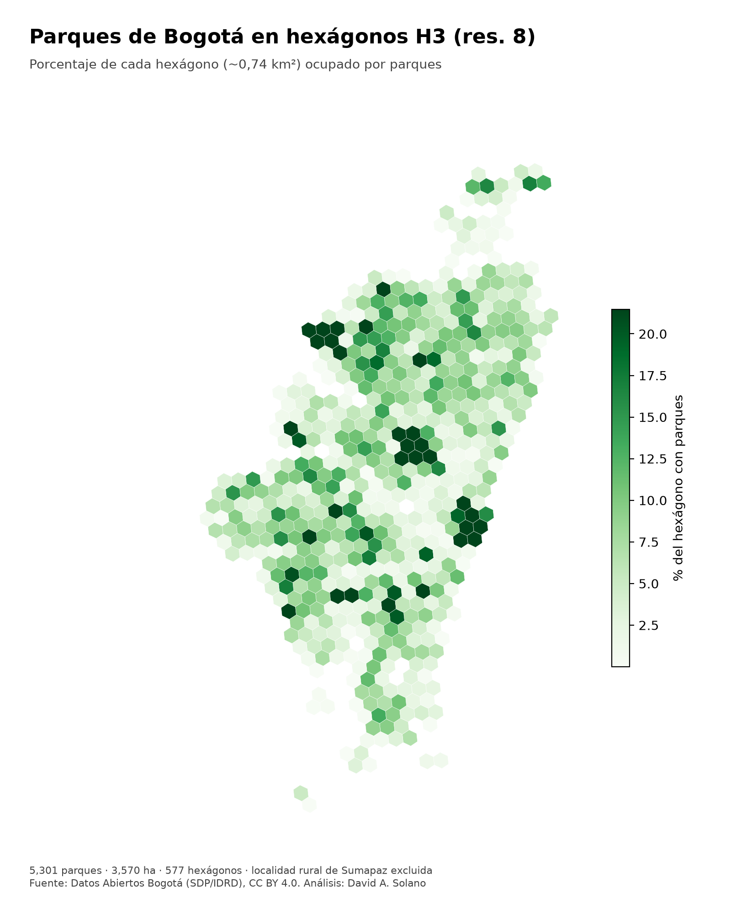
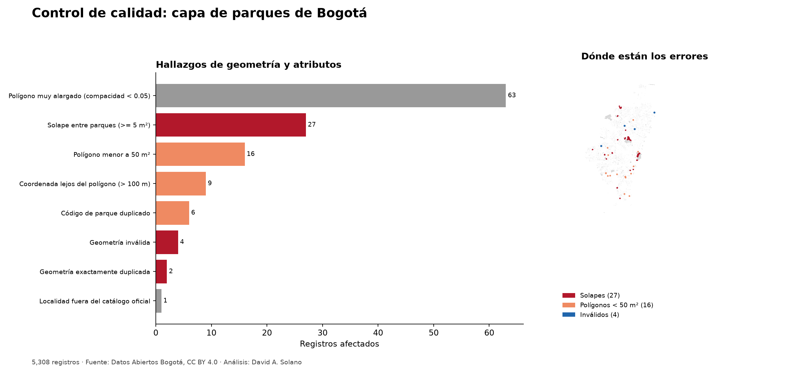

# Parques de Bogotá: análisis espacial y control de calidad

Dos piezas de análisis geoespacial con datos abiertos de Bogotá, hechas con Python (GeoPandas, H3, folium).

| | Pieza | Qué muestra |
|---|---|---|
| 1 | [Cobertura de parques en hexágonos H3](README_h3.md) | Agregación espacial en hexágonos H3 de ~0,74 km², con mapa interactivo |
| 2 | [Control de calidad espacial](README_qa.md) | Detección de errores de geometría y atributos en la capa oficial, con capas de error para corregir en GIS |




## Datos
**Sistema Distrital de Parques y Escenarios Públicos Deportivos**, Datos Abiertos Bogotá (licencia CC BY 4.0):
https://datosabiertos.bogota.gov.co/dataset/sistema-distrital-de-parques-y-escenarios-publicos-deportivos

El archivo no se incluye en este repositorio. Descargue `parques.geojson` y guárdelo en una carpeta `datos/`.

## Cómo reproducir
```bash
pip install geopandas h3 folium matplotlib shapely pyproj
python parques_h3.py
python parques_qa_topologia.py
```

## Autor
David Alexis Solano Cortes · Ingeniero Ambiental y Sanitario · Analista GIS
Bogotá, Colombia · [LinkedIn](https://www.linkedin.com/) (agregar enlace)

Código bajo licencia MIT. Los datos pertenecen a sus autores (CC BY 4.0).
