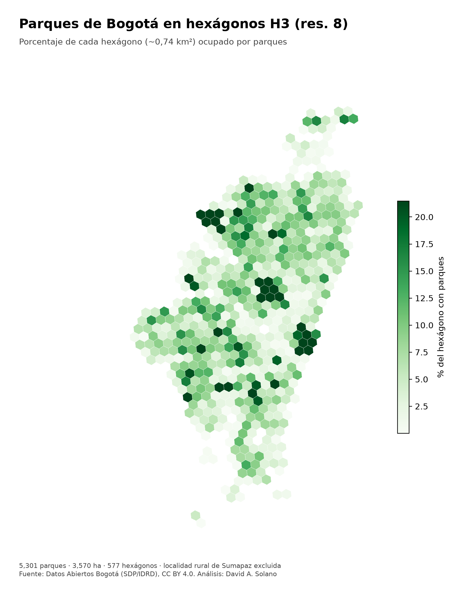

# Parques de Bogotá en hexágonos H3

Análisis espacial de la cobertura de parques públicos de Bogotá agregada en hexágonos H3 (resolución 8, ~0,74 km²).



**Mapa interactivo:** `salida/mapa_parques_h3.html` (abrir en el navegador).

## Problema
¿Cómo se distribuyen los parques dentro de la ciudad? Los datos vienen por polígono y por localidad, lo que oculta diferencias dentro de cada localidad. Una malla hexagonal uniforme permite compararlas sin depender de límites administrativos.

## Datos
- **Sistema Distrital de Parques y Escenarios Públicos Deportivos** (5.308 polígonos), Datos Abiertos Bogotá, licencia CC BY 4.0.
  https://datosabiertos.bogota.gov.co/dataset/sistema-distrital-de-parques-y-escenarios-publicos-deportivos
- El archivo descargado se guarda en `datos/parques.geojson`. Revisar la fecha de actualización en el portal antes de citar cifras.

## Método
1. **Control de calidad** (`salida/control_calidad.csv`): 4 geometrías inválidas reparadas con `make_valid`, 3 parques propuestos excluidos, 1 localidad con error de digitación corregida, 4 parques de la localidad rural de Sumapaz excluidos, 3 códigos duplicados revisados.
2. **Áreas en m²** reproyectando a MAGNA-SIRGAS / Colombia Bogotá (EPSG:3116); se usa la unión de polígonos para no contar dos veces los solapes.
3. **Malla H3** (resolución 8) sobre el área con parques.
4. **Métricas por hexágono:** porcentaje del hexágono ocupado por parques (intersección real, no solo el centroide), número de parques y número de parques de bolsillo.
5. **Salidas:** GeoPackage, mapa interactivo (folium) e imagen estática (matplotlib).

## Resultados (ver `salida/resumen.json`)
- 5.301 parques analizados, unas 3.570 ha de parques en 577 hexágonos.
- Mediana: 5,65 % de cada hexágono ocupado por parques; 126 hexágonos superan el 10 % y 69 no llegan al 1 %.
- Engativá, Suba y Santa Fe concentran la mayor área de parques.
- Hay 1.645 parques de bolsillo, muy numerosos pero con muy poca área (unas 102 ha en total).

## Limitaciones
- La métrica es área de parques sobre área del hexágono. No considera población, por lo que no mide acceso per cápita.
- Los hexágonos de borde incluyen suelo no urbano (cerros, humedales, zonas sin parques inventariados); un valor bajo allí no es un déficit.
- Solo incluye los parques del inventario distrital, no bosques ni reservas.

## Reproducir
```bash
pip install geopandas h3 folium matplotlib shapely pyproj
python parques_h3.py
```

Análisis: David Alexis Solano Cortes · Datos: Datos Abiertos Bogotá (CC BY 4.0)
