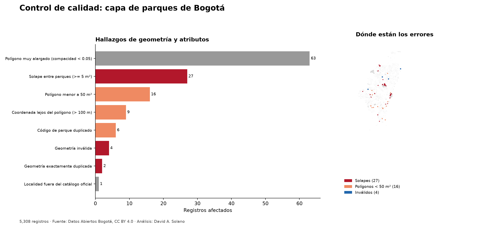

# Control de calidad espacial: capa de parques de Bogotá

Revisión automática de geometrías y atributos de una capa pública de 5.308 polígonos, con un informe y capas de error listas para corregir en ArcGIS Pro o QGIS.



## Problema
Una capa oficial puede estar publicada y aun así traer errores que afectan cualquier análisis posterior (áreas mal calculadas, parques contados dos veces, polígonos rotos). Esta pieza muestra cómo detectarlos de forma reproducible, en lugar de revisarlos a mano.

## Datos
**Sistema Distrital de Parques y Escenarios Públicos Deportivos**, Datos Abiertos Bogotá (CC BY 4.0).
https://datosabiertos.bogota.gov.co/dataset/sistema-distrital-de-parques-y-escenarios-publicos-deportivos
Descargar `parques.geojson` en la carpeta `datos/`.

## Reglas de control
| Regla | Criterio | Resultado |
|---|---|---|
| Geometría inválida | `explain_validity` | 4 (autointersección de anillo) |
| Solape entre parques | Intersección >= 5 m² | 27 solapes, ~13,8 ha en total |
| Polígono diminuto | Área < 50 m² | 16 |
| Polígono muy alargado | Compacidad 4πA/P² < 0,05 | 63 (a revisar: pueden ser corredores) |
| Geometría duplicada | Igualdad exacta | 2 |
| Código de parque duplicado | `Codigo_Parque` repetido | 6 registros (3 códigos) |
| Coordenada vs. polígono | Atributo X/Y a más de 100 m del centroide | 9 |
| Nulos | Por campo | `Administra` 97 % y `TIPOLOGIA` 73 % vacíos |
| Catálogo de localidades | 20 localidades oficiales | 1 error ("SANATFE") |
| Unidad del área | `SHAPE.AREA` | Está en grados², no en m²: no sirve como área real |

## Qué se entrega
- `salida_qa/informe_qa.csv`: tabla de hallazgos con severidad.
- `salida_qa/errores_parques.gpkg`: una capa por tipo de error (para abrir en GIS y corregir).
- `salida_qa/resumen_qa.png`: figura resumen.

## Método
Todo se calcula en MAGNA-SIRGAS / Colombia Bogotá (EPSG:3116) para medir áreas y distancias en metros. Los solapes se detectan con un índice espacial (`sindex`) y no comparando todos los pares.

## Limitaciones
- Los umbrales (50 m², 5 m², 100 m, compacidad 0,05) son criterios de trabajo, no normas. Cada proyecto debe ajustarlos.
- Un polígono alargado o pequeño no siempre es un error: puede ser un corredor o un parque de bolsillo real. Por eso se marca para revisión y no se corrige automáticamente.
- No se compararon los datos con la realidad en campo ni con imágenes.

## Reproducir
```bash
pip install geopandas matplotlib shapely pandas numpy pyproj
python parques_qa_topologia.py
```

Análisis: David Alexis Solano Cortes · Datos: Datos Abiertos Bogotá (CC BY 4.0)
